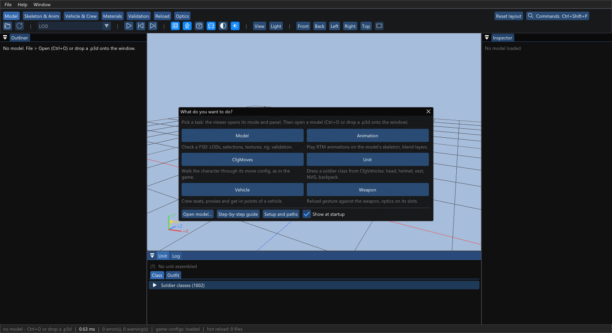
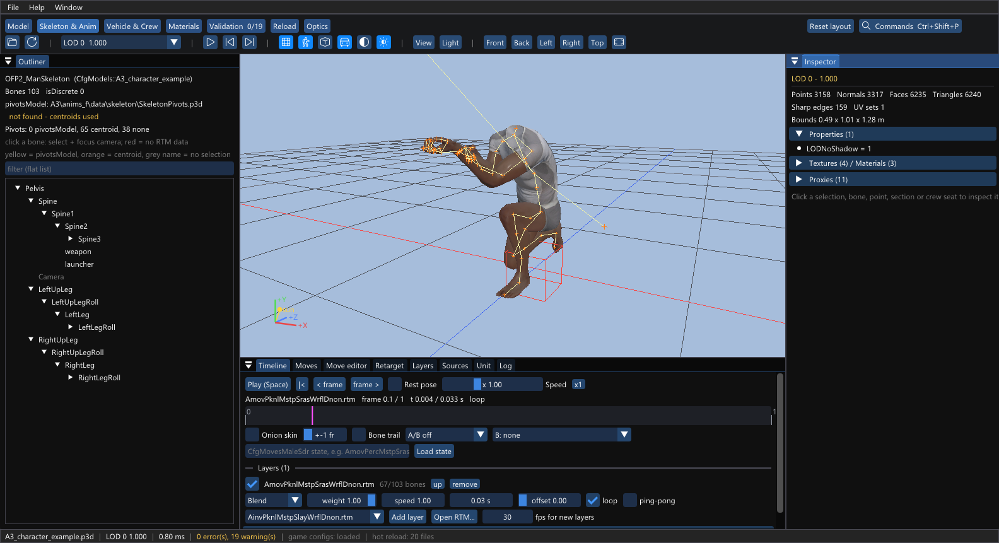
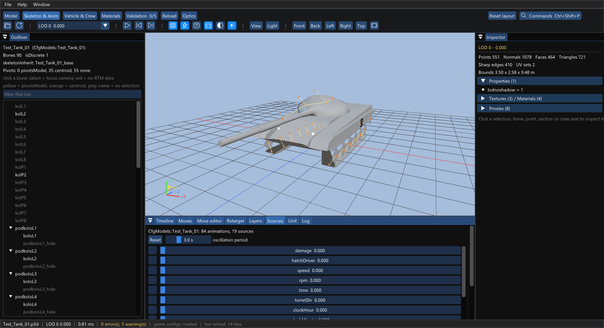
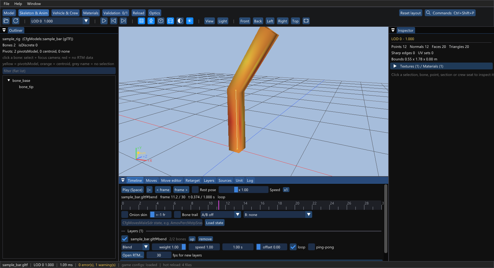

# ArmaView

A standalone viewer for Arma 3 source content: models, animations, move configs, vehicles with crew and soldiers
dressed from their config, without starting the game. It reads the unbinarized source formats (MLOD, RTM) and glTF.
Русская версия: [README.ru.md](README.ru.md).






## Features

- **Models:** P3D MLOD, every LOD, named selections and proxies, hide / isolate parts, normal and tangent checks,
  Validation with links to the `model.cfg` lines, hot reload when the file is saved.
- **glTF:** `.gltf` / `.glb` models with their UVs, materials (base color, normal map), skeleton, skin weights and
  animations; the clips become layers on the Timeline. Open from the menu or drop the file onto the window.
- **Animations:** RTM (RTM_0101), skeletons and pivots from `model.cfg`, a timeline, layers on top of an animation
  (offset / additive / replace with masks), clip operations, writing a new RTM, batch processing, retargeting between
  skeletons with foot IK.
- **CfgMoves:** a graph of all states with search and filters, playMove / switchMove along the shortest path, gestures
  with BlendAnims masks, a control mode (WASD + root motion), scenario tests and trap search, an editor for your own
  configs (diff, `.bak`, Validation after saving).
- **Unit:** a soldier class assembled from `CfgVehicles` as the game dresses it: the class's model as the uniform, the
  head from its face, headgear, vest and NVG from `linkedItems[]`, the backpack; every part on one skeleton, following
  the animation; the reason when a part cannot be shown (parts must be source MLOD files).
- **Vehicles and crew:** crew on the proxies from `CfgVehicles`, seat poses, turned in / out, get-in points, the
  `model.cfg` graph with the animation sources.
- **Weapons:** Reload mode (the reload gesture on a character holding the weapon, a shared timeline, min/max windows of
  the `model.cfg` animations edited with the mouse) and Optics mode (items on the slot proxies, barrel and sight axes,
  the view through the sight).
- **Materials and light:** RVMAT (Super, Multi, Skin and others), PAA, world lighting from `LightingNew`, shadows,
  reflections, damage states.
- **Blender:** preview from Blender through Arma 3 Object Builder (a3ob), opening a baked clip in Blender.
- **Start screen and setup:** "What do you want to do?" opens the right mode; the first start shows which paths the
  viewer found (P:, game data, Arma 3 Samples, Blender, ffmpeg); tooltips on the controls; English and Russian UI.

## Supported formats

| Format | Read | Notes |
|---|---|---|
| MLOD (P3D source) | yes | every LOD, selections with weights, proxies, UV sets, named properties |
| RTM_0101 (and RTM_0100) | yes, writes RTM_0101 | skeletal animations; new clips and retarget results are written as RTM_0101 |
| PAA / PAC | yes | DXT1-5, ARGB, LZO / LZSS; TGA, PNG and JPEG textures too |
| glTF 2.0 (`.gltf`, `.glb`) | yes | meshes, UVs, base color / normal textures, skeleton and skin, animations |
| Configs (`config.cpp`, `model.cfg`, `.rvmat`, `config.bin`) | yes | text with the preprocessor, and rapified binary configs |

Binarized game / mod files are not supported by design: use unbinarized sources, Arma 3 Samples, or the official glTF
export. A binarized model or animation is reported with "Binarized files are not supported — open the unbinarized
source (MLOD / RTM)"; a binarized proxy or crew pose is shown as a frame with its name.

## What you need

- Windows 10 or 11, 64-bit, a Direct3D 11 GPU (without one it falls back to the WARP software renderer).
- Optional: **a P: drive with the unpacked game data** (`P:\a3\...`), as set up by Arma 3 Tools (Project Drive
  Management): BI's base configs (CfgMoves, CfgVehicles, CfgWeapons) and textures come from there. Your own mods are
  expected on P: as well. Without P: the viewer still opens a model file, but config inheritance stops at the game's
  classes and BI textures are missing.
- Optional: Arma 3 Samples (Steam), Blender with a3ob, ffmpeg for video recording.

## First start

1. Unzip and run `ArmaView.exe` (no installer, one exe).
2. The **Setup and paths** window shows the settings folder, whether P: and the game data were found, and the optional
   tools. Arma 3 Samples and Blender can be set there (saved to `armaview.local.ini` in the settings folder; used
   after a restart).
3. The **start screen** asks what you want to do (Model, Animation, CfgMoves, Unit, Vehicle, Weapon) and opens that
   mode. Then open a model: Ctrl+O, or drop a `.p3d`, `.gltf` or `.glb` onto the window.

Settings, window layouts and the log (`ArmaView.log`) are kept in `%LOCALAPPDATA%\ArmaView`. Portable mode: run
with `--portable` or put an empty `portable.txt` next to the exe; everything is then kept next to the exe.
Help > Start screen / Setup and paths / Getting started open these windows again; F1 lists every key.

## Known limitations

- **Lighting is approximate:** it follows the world's `LightingNew` and the RVMAT stages, but it is not the game's
  renderer; colors, shadows and reflections are close, not 1:1.
- **Source files only:** binarized models and animations are not read (see Supported formats). Packed PBOs are not
  read either; the viewer works on unpacked files. Anything that depends on BI configs or textures needs P: with the
  game data.
- **The viewer does not write P3D.** It writes only what you ask it to: new RTM files, `model.cfg` animation windows,
  RVMAT values and your own config edits, each with a `.bak` next to the file.
- **Crew poses** come from the RTM files named in CfgMovesMaleSdr; a pose that is not a source RTM is shown as a
  frame instead of a posed character.
- **glTF:** morph targets and extra UV sets are not read; cubic spline animation keys are sampled linearly; a mesh
  that is not skinned is placed with its node transform.
- **Unit:** classes are looked up in the open model's addon config and in the game configs on P:. The game picks a
  face at random; the viewer shows the first one that matches (replaceable in the Unit window). Gear is skinned by bone
  name: on a custom skeleton, parts on bones it does not have stay in their bind pose (the Unit window lists them).
- Windows only.

## Building

Requirements: Visual Studio 2022 or 2026 with C++ (C++23), CMake 3.28 or newer, vcpkg (`VCPKG_ROOT` set).
Dependencies come from `vcpkg.json` automatically.

Release (static runtime, one exe without DLLs):

```bash
cmake --preset vs2026-static
```

```bash
cmake --build --preset release
```

The result is `build/vs2026-static/Release/ArmaView.exe`. With Visual Studio 2022 use the `ci` presets
(`cmake --preset ci`, `cmake --build --preset ci`). For development: `cmake --preset vs2026` and
`cmake --build --preset dev` (RelWithDebInfo). Machine-specific paths (vcpkg caches, TEMP of the build) go into
`CMakeUserPresets.json`: copy `CMakeUserPresets.json.example` and use the `*-local` presets.

Tests:

- `armaview-cli selftest`: the core (parsers, configs, CfgMoves, glTF import, unit assembly, settings, short
  fuzzing) on files it writes itself; needs no window and no game data. GitHub Actions runs it for every version tag (`v*`) and attaches the zip to the release.
- `ArmaView.exe --selftest <folder>`: the whole viewer on Arma 3 Samples (`samples=` in `armaview.local.ini`, see
  `armaview.local.ini.example`) and a generated glTF; the game data on P: is not used. Without the Samples only the
  core part runs. The exit code is not 0 when the log has errors.
- `tools/sandbox/Run-SandboxTest.ps1`: first start of a release zip in Windows Sandbox (a clean machine).

## Blender

1. Install [Arma 3 Object Builder (a3ob)](https://github.com/MrClock8163/Arma3ObjectBuilder).
2. Edit > Preferences > Add-ons > Install from Disk > `tools/blender/armaview_preview.py`, enable the add-on.
3. In the add-on settings, set the path to `ArmaView.exe` (empty by default; the panel asks for it).
4. The panel: 3D Viewport > side panel (N) > ArmaView.

## Keys

| Key | Action |
|---|---|
| F1 | help with every key |
| Ctrl+Shift+P | command palette |
| Ctrl+O | open a model (P3D, glTF) / RTM |
| F5 | reload the model |
| Ctrl+1...7 | modes: Model, Skeleton & Anim, Vehicle & Crew, Materials, Validation, Reload, Optics |
| LMB / RMB / wheel | rotate / pan / zoom the camera |
| F | frame the model |
| 1-5 | front, back, left, right, top view |
| Page Up / Page Down | previous / next LOD |
| H / Shift+H / Alt+H | hide / isolate / show all |
| B / W / G | skeleton / wireframe / floor grid |
| Space, Left / Right | play, frame back / forward |
| Ctrl+G | `model.cfg` graph |
| Ctrl+M | CfgMoves states graph |
| Ctrl+R | crew (Vehicle & Crew) |

## Reporting problems

Use the issue templates (bug report / feature request). For a bug, attach `ArmaView.log` from
`%LOCALAPPDATA%\ArmaView` and, after a crash, the report from `%LOCALAPPDATA%\ArmaView\crashes`.

## Third-party software

- [Dear ImGui](https://github.com/ocornut/imgui), MIT
- [imgui-node-editor](https://github.com/thedmd/imgui-node-editor), MIT
- [GLM](https://github.com/g-truc/glm), MIT (or the Happy Bunny License)
- [cgltf](https://github.com/jkuhlmann/cgltf), MIT

The license texts are in [THIRD_PARTY_LICENSES](THIRD_PARTY_LICENSES).

## License

MIT, see [LICENSE](LICENSE). Copyright (c) 2026 Pin.

---

Arma 3 is a trademark of Bohemia Interactive. This project is not affiliated with or endorsed by Bohemia Interactive.
