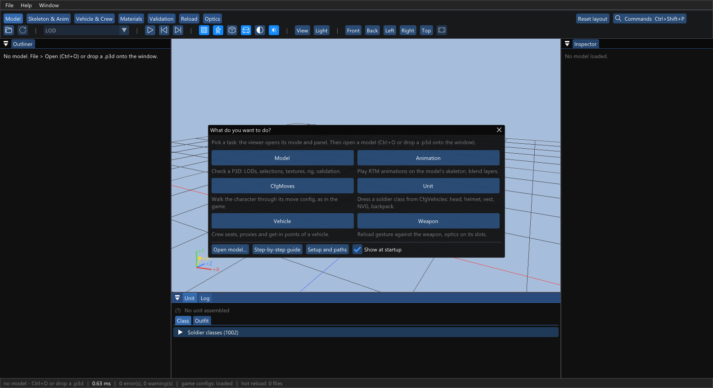
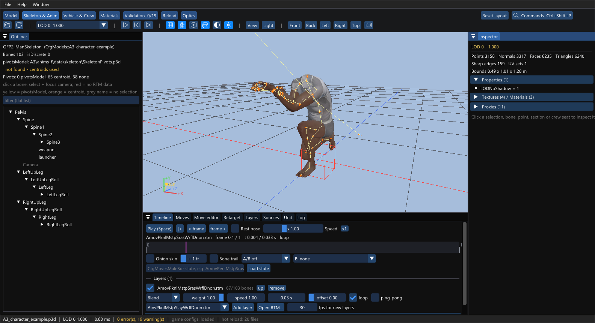
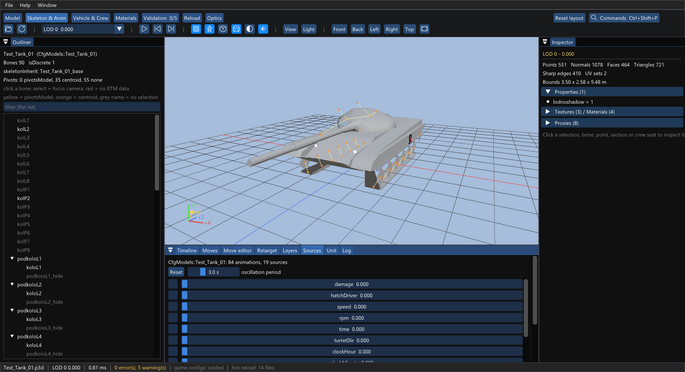
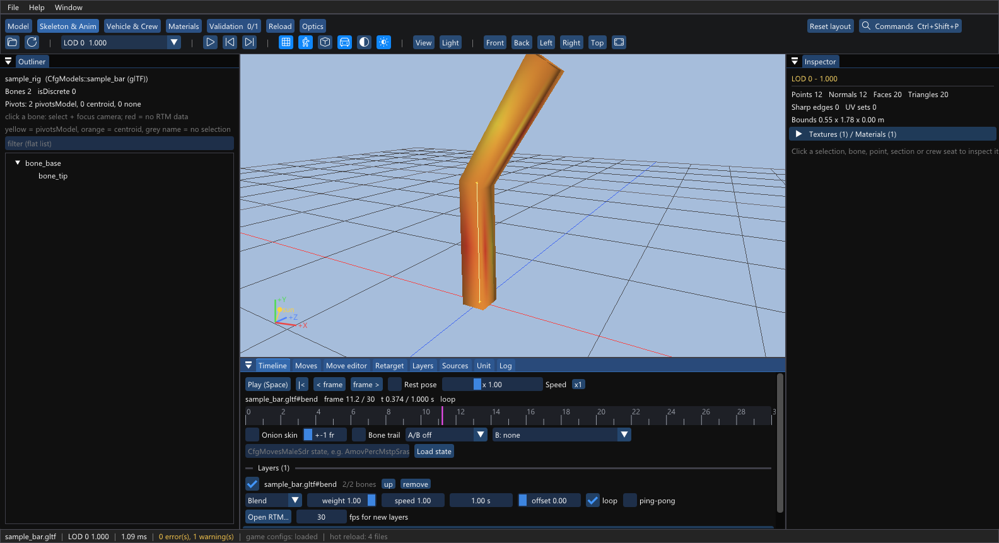
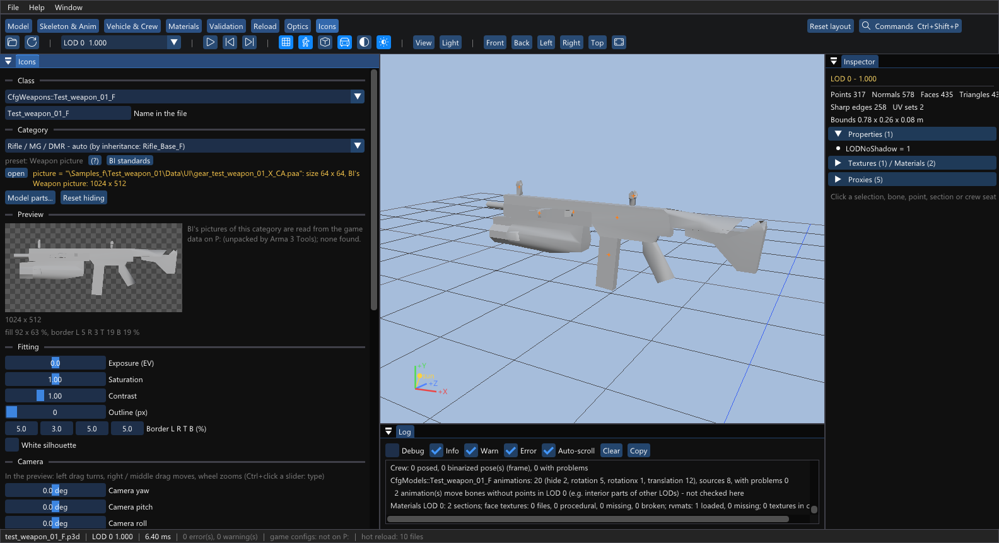

# ArmaView

Отдельный просмотрщик исходного контента Arma 3: модели, анимации, конфиги движений, техника с экипажем и солдаты,
одетые по своему конфигу, без запуска игры. Читает небинаризованные исходные форматы (MLOD, RTM) и glTF.
English: [README.md](README.md).






## Возможности

- **Модели:** P3D MLOD, все LOD, выделения и прокси, скрытие и изоляция частей, проверка нормалей и касательных,
  Validation со ссылками на строки `model.cfg`, горячая перезагрузка при сохранении.
- **glTF:** модели `.gltf` / `.glb` с UV, материалами (base color, карта нормалей), скелетом, весами скина и
  анимациями; клипы становятся слоями на таймлайне. Открытие из меню или перетаскиванием файла в окно.
- **Анимации:** RTM (RTM_0101), скелеты и pivots из `model.cfg`, таймлайн, слои поверх анимации (offset / additive /
  replace с масками), операции с клипом, запись нового RTM, пакетная обработка, ретаргетинг между скелетами с IK стоп.
- **CfgMoves:** граф всех состояний с поиском и фильтрами, playMove / switchMove по кратчайшему пути, жесты с масками
  BlendAnims, режим управления (WASD + root motion), тесты сценариев и поиск ловушек, редактор своих конфигов (diff,
  `.bak`, Validation после сохранения).
- **Юнит:** класс солдата из `CfgVehicles`, одетый как в игре: модель класса - униформа, голова из лица, шлем, жилет и
  ПНВ из `linkedItems[]`, рюкзак; все части на одном скелете и идут за анимацией; если часть не показана - причина
  (части должны быть исходными MLOD).
- **Техника и экипаж:** экипаж на прокси по `CfgVehicles`, позы мест, люки, точки посадки, граф `model.cfg` с
  источниками анимаций.
- **Оружие:** режим Reload (жест перезарядки на персонаже с оружием, общий таймлайн, окна min/max анимаций `model.cfg`
  с правкой мышью) и режим Optics (предметы на прокси слотов, оси ствола и прицела, вид через прицел).
- **Материалы и свет:** RVMAT (Super, Multi, Skin и др.), PAA, освещение миров по `LightingNew`, тени, отражения,
  состояния повреждений.
- **Иконки:** картинки UI для классов мода по стандартам BI (см. [Иконки](#иконки)).
- **Blender:** просмотр из Blender через Arma 3 Object Builder (a3ob), открытие запечённого клипа в Blender.
- **Стартовый экран и настройка:** «Что хотите сделать?» открывает нужный режим; при первом запуске видно, какие пути
  найдены (P:, данные игры, Arma 3 Samples, Blender, ffmpeg); подсказки на элементах; интерфейс на русском и английском.

## Иконки

Режим Icons (Ctrl+8) делает картинки UI для классов мода так, как их делает Bohemia: перечисляет классы
`scope = 2` конфига мода с моделью на диске, показывает каждый со своей моделью и перекраской (униформа - на солдате
её `uniformClass`, жилет и шлем - в надетом виде) и рисует картинку вне экрана.



- **Пресеты по стандартам BI:** превью редактора (JPG 455 x 256 на VR-земле, камера BI), оружие (1024 x 512, вид
  сбоку, дулом влево), снаряжение (256 x 256), головной убор (256 x 256, вид 3/4), обвес / магазин (256 x 256),
  картинка техники (белый силуэт 128 x 64) и иконка на карте (512 x 512, сверху), свой. Категория берётся по
  наследованию класса (базовый класс показан) или выбирается вручную; числа (размер, отступы, вид, фон, имя файла,
  папка) - медианы картинок самой BI, см. [docs/icons.md](docs/icons.md) и окно «Стандарты BI».
- **Подгонка:** экспозиция, насыщенность, контраст, обводка, белый силуэт, отступы; камера (поворот / наклон / крен,
  приближение, цель) ползунками или мышью в превью; части модели скрываются только для картинки; всё хранится по
  классу.
- **Примеры BI рядом с превью:** читаются из ваших данных игры на P: во время работы (классы scope=2 той же
  категории с картинкой на диске); ничего из BI в ArmaView не входит.
- **Результат:** PNG с альфой, JPG для превью редактора, PAA через `ImageToPAA.exe` из Arma 3 Tools (Steam;
  находится сам или указывается в окне). Имя файла и папка - по правилу BI (`gear_<класс>_X_ca.paa`,
  `icon_<класс>_ca.paa`, `map_<класс>_ca.paa`, `<Класс>.jpg` в `data\ui` / `data\editorpreviews`); окно даёт строку
  для конфига, например `picture = "\mymod\data\ui\gear_my_rifle_F_X_ca.paa";`.
- **Пакет:** все классы списка за один раз (картинки, иконки техники на карте, превью редактора).
- **Превью редактора в игре:** «SQF для игры» копирует вызов только для классов CfgVehicles мода, например
  `[1, "all", [], [], [], ["My_Car_F", "My_Soldier_F"]] spawn BIS_fnc_exportEditorPreviews;` (запустите в редакторе;
  снимки попадают в `Screenshots\EditorPreviews`).
- **Проверки:** картинки, которые уже указаны в конфиге мода, сверяются со стандартом своей категории (нет файла,
  размер, `_co` вместо `_ca`, нет альфы, папка, PAA не степени двойки) - в окне и в Validation.
- Персонажи для превью редактора одеваются системой Unit только из исходных частей (MLOD, текстовые RTM: Arma 3
  Samples или свои); бинаризованная модель или часть снаряжения не рисуется, и окно пишет, какая часть и почему.

## Поддерживаемые форматы

| Формат | Чтение | Примечания |
|---|---|---|
| MLOD (исходник P3D) | да | все LOD, выделения с весами, прокси, наборы UV, именованные свойства |
| RTM_0101 (и RTM_0100) | да, пишет RTM_0101 | скелетные анимации; новые клипы и результаты ретаргета пишутся в RTM_0101 |
| PAA / PAC | да | DXT1-5, ARGB, LZO / LZSS; также текстуры TGA, PNG и JPEG |
| glTF 2.0 (`.gltf`, `.glb`) | да | меши, UV, текстуры base color / normal, скелет и скин, анимации |
| Конфиги (`config.cpp`, `model.cfg`, `.rvmat`, `config.bin`) | да | текст с препроцессором и бинарные (rapified) конфиги |

Бинаризованные файлы игры и модов не поддерживаются намеренно: используйте небинаризованные исходники, Arma 3 Samples
или официальный экспорт в glTF. На бинаризованную модель или анимацию выводится сообщение "Binarized files are not
supported — open the unbinarized source (MLOD / RTM)"; бинаризованный прокси или поза экипажа показываются рамкой с
именем.

## Что нужно

- Windows 10 или 11, 64-бит, видеокарта с Direct3D 11 (без неё - программный рендер WARP).
- Необязательно: **диск P: с распакованными данными игры** (`P:\a3\...`), как его готовит Arma 3 Tools (Project Drive
  Management): оттуда берутся базовые конфиги BI (CfgMoves, CfgVehicles, CfgWeapons) и текстуры. Свои моды тоже
  ожидаются на P:. Без P: модель откроется, но наследование конфигов обрывается на классах игры и текстур BI нет.
- Необязательно: Arma 3 Samples (Steam), Blender с a3ob, ffmpeg для записи видео.

## Первый запуск

1. Распакуйте zip и запустите `ArmaView.exe` (без установки, один exe).
2. Окно **«Настройка и пути»** показывает папку настроек, найдены ли P: и данные игры, и необязательные инструменты.
   Там же можно указать Arma 3 Samples и Blender (сохраняются в `armaview.local.ini` в папке настроек и действуют
   после перезапуска).
3. **Стартовый экран** спрашивает, что вы хотите сделать (Модель, Анимация, CfgMoves, Юнит, Техника, Оружие), и
   открывает этот режим. Затем откройте модель: Ctrl+O или перетащите `.p3d`, `.gltf` или `.glb` в окно.

Настройки, раскладки окон и журнал (`ArmaView.log`) хранятся в `%LOCALAPPDATA%\ArmaView`. Портативный режим:
запуск с `--portable` или пустой `portable.txt` рядом с exe - тогда всё хранится рядом с exe.
Справка > Стартовый экран / Настройка и пути / Первые шаги открывают эти окна снова; F1 - все клавиши.

## Известные ограничения

- **Освещение приближённое:** следует `LightingNew` мира и стадиям RVMAT, но это не рендер игры; цвета, тени и
  отражения близки, но не 1:1.
- **Только исходные файлы:** бинаризованные модели и анимации не читаются (см. «Поддерживаемые форматы»). Упакованные
  PBO тоже не читаются, работа идёт с распакованными файлами. Всё, что зависит от конфигов и текстур BI, требует P: с
  данными игры.
- **Вьювер не записывает P3D.** Он пишет только то, что вы попросите: новые RTM, окна анимаций в `model.cfg`, значения
  RVMAT и правки своих конфигов, каждый раз с `.bak` рядом.
- **Позы экипажа** берутся из RTM, указанных в CfgMovesMaleSdr; поза, которая не является исходным RTM, показывается
  рамкой, а не позированным персонажем.
- **glTF:** morph targets и дополнительные наборы UV не читаются; ключи cubic spline сэмплируются линейно; меш без
  скина ставится по трансформации своего узла.
- **Юнит:** классы ищутся в конфиге аддона открытой модели и в игровых конфигах на P:. Игра выбирает лицо случайно,
  вьювер показывает первое подходящее (можно заменить в окне Unit). Снаряжение скинится по именам костей: на своём
  скелете части на костях, которых в нём нет, остаются в позе привязки (окно Unit их перечисляет).
- Только Windows.

## Сборка

Нужно: Visual Studio 2022 или 2026 с C++ (C++23), CMake 3.28 или новее, vcpkg (задана `VCPKG_ROOT`). Зависимости
ставятся из `vcpkg.json` автоматически.

Release (статический рантайм, один exe без DLL):

```bash
cmake --preset vs2026-static
```

```bash
cmake --build --preset release
```

Результат: `build/vs2026-static/Release/ArmaView.exe`. С Visual Studio 2022 - пресеты `ci` (`cmake --preset ci`,
`cmake --build --preset ci`). Для разработки: `cmake --preset vs2026` и `cmake --build --preset dev` (RelWithDebInfo).
Пути своей машины (кэши vcpkg, TEMP сборки) - в `CMakeUserPresets.json`: скопируйте `CMakeUserPresets.json.example` и
используйте пресеты `*-local`.

Проверки:

- `armaview-cli selftest`: ядро (парсеры, конфиги, CfgMoves, импорт glTF, сборка юнита, настройки, короткий
  фаззинг) на файлах, которые он пишет сам; без окна и без данных игры. GitHub Actions запускает его на каждый тег версии (`v*`) и прикладывает zip к релизу.
- `ArmaView.exe --selftest <папка>`: весь вьювер на Arma 3 Samples (`samples=` в `armaview.local.ini`, см.
  `armaview.local.ini.example`) и сгенерированном glTF; данные игры на P: не используются. Без Samples выполняется
  только часть ядра. Код выхода не 0, если в журнале есть ошибки.
- `tools/sandbox/Run-SandboxTest.ps1`: первый запуск zip релиза в Windows Sandbox (чистая машина).

## Blender

1. Установите [Arma 3 Object Builder (a3ob)](https://github.com/MrClock8163/Arma3ObjectBuilder).
2. Edit > Preferences > Add-ons > Install from Disk > `tools/blender/armaview_preview.py`, включите аддон.
3. В настройках аддона укажите путь к `ArmaView.exe` (по умолчанию пусто; панель попросит его указать).
4. Панель: 3D Viewport > боковая панель (N) > ArmaView.

## Сообщить о проблеме

Используйте шаблоны issue (ошибка / предложение). К ошибке приложите `ArmaView.log` из `%LOCALAPPDATA%\ArmaView`, а
после падения - отчёт из `%LOCALAPPDATA%\ArmaView\crashes`.

## Сторонние библиотеки

- [Dear ImGui](https://github.com/ocornut/imgui), MIT
- [imgui-node-editor](https://github.com/thedmd/imgui-node-editor), MIT
- [GLM](https://github.com/g-truc/glm), MIT (или Happy Bunny License)
- [cgltf](https://github.com/jkuhlmann/cgltf), MIT

Тексты лицензий - в [THIRD_PARTY_LICENSES](THIRD_PARTY_LICENSES).

## Лицензия

MIT, см. [LICENSE](LICENSE). Copyright (c) 2026 Pin.

---

Arma 3 - торговая марка Bohemia Interactive. Проект не связан с Bohemia Interactive и не одобрен ею.
